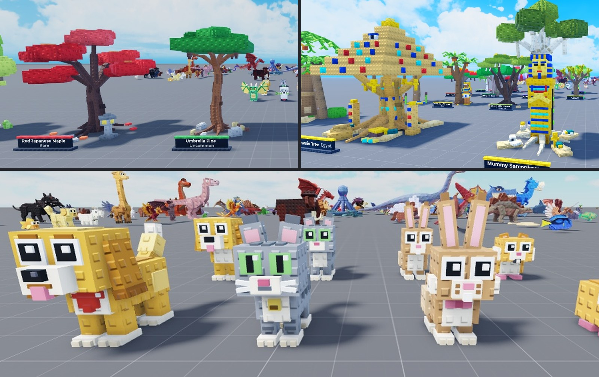

# BlockForge

A local 3D modeling tool for block-built, stud-style models. Start from a picture or a blank scene, build the model from parts in the browser editor, check it against the reference, and export it to Roblox Studio or any 3D tool.



## Features

| | |
| --- | --- |
| **Editor** | Block modeling in the browser: parts, groups, mirroring, snapping, materials and colours |
| **References** | Pictures from your own files or generated in the app, with background removal |
| **3D scan** | Image-to-3D reconstruction (TRELLIS, Hunyuan3D, SAM 3D, or ComfyUI on your own GPU) used as a size and depth guide |
| **AI build** | An optional AI model plans and builds the parts from the references |
| **Checks** | Side-by-side renders, silhouette match against the picture, automatic polish |
| **MCP** | An MCP server that lets an AI client drive the editor with the same tools |
| **Export** | Roblox `.rbxmx` and a Studio script, plus GLB and OBJ |

## Requirements

- [Node.js](https://nodejs.org) 20 or later
- A modern browser

## Installation

```sh
git clone https://github.com/zielonyxiom/blockforge.git
cd blockforge
npm install
npm start
```

Open http://localhost:5177. Keys and options are set in the app under **Settings**, or in a `.env` file based on `.env.example`. None are required to model by hand.

## Workflow

1. **Reference.** Create a project and add a picture of what you want to model.
2. **Scan.** Optionally reconstruct the picture in 3D to get true proportions and depth.
3. **Build.** Place parts by hand, let the AI build a first pass, or drive the editor from an MCP client.
4. **Check.** Compare renders with the picture and the scan from every side, then polish.
5. **Export.** Download `.rbxmx`, GLB or OBJ, or paste the generated script into Roblox Studio.

## Configuration

| Setting | Purpose |
| --- | --- |
| `HF_TOKEN` | Hugging Face token for 3D scans and background removal (free, recommended) |
| `MESH_BACKEND` | Scan model: `trellis`, `trellis2`, `hunyuan3d`, `hunyuan21`, `sam3d` or `comfyui` |
| `LLM_PROVIDER` | AI build provider: `gemini`, `openrouter`, `ollama`, `openai` or `anthropic` |
| `PORT` | Editor port, default `5177` |

The full list with defaults is in `.env.example`. The `.env` file stays on your machine and is ignored by git.

## MCP

```sh
npm run mcp:install
```

This registers the server with Claude Code when it is installed, and otherwise prints the entry to add to any MCP client. Keep BlockForge running with the editor open while the client works.

## Project structure

| Folder | Contents |
| --- | --- |
| `server/` | Local server: project storage, build pipeline, scan backends, exporters |
| `public/` | Browser editor |
| `mcp/` | MCP server |
| `scripts/` | Setup scripts |
| `style/` | Your own style example pictures (optional, not committed) |
| `docs/` | Images used by this README |

## Third-party models

Scans and background removal run on third-party models. BRIA RMBG-2.0 and Hunyuan3D-2.1 are licensed for non-commercial use only. Check each model's license before commercial work.

---

Released under the [MIT License](LICENSE). Maintained by zielonyxiom.
