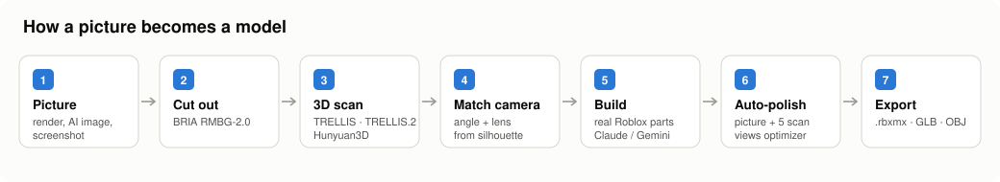
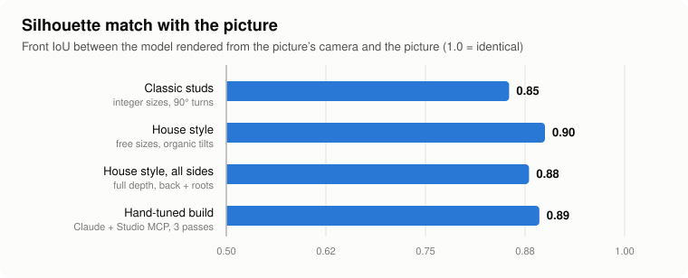
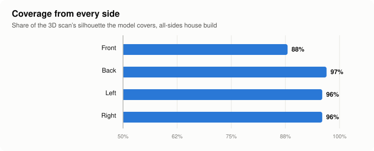

<div align="center">

# ▣ BlockForge

### Picture in, Roblox model out: an almost 1:1, stud-style build from real Parts.

[](LICENSE)


**[Install](#️-download--install) · [Free keys](#-free-keys-2-minutes) · [Use it](#-how-to-use) · [Claude Code](#-best-quality-build-with-claude-code) · [How it works](#-how-the-almost-11-works) · [Troubleshooting](#️-troubleshooting)**

</div>

Drop in a picture. BlockForge scans it into 3D, rebuilds it out of real Roblox parts, checks itself against your picture from the same camera angle, polishes the build automatically and exports a file you can drag into Roblox Studio.

| | |
|---|---|
| 🧊 **Free 3D scans** | TRELLIS, TRELLIS.2 and Hunyuan3D-2 on Hugging Face, with background removal |
| 🎯 **Self-checking** | renders the model from your picture's camera; red = missing, blue = extra, plus a score |
| ✨ **Auto-polish** | optimizes every part against the picture and 5 scan views |
| 🟥 **Roblox-native** | stud scale, BrickColors, 21 materials, anchored Parts and WedgeParts in named Models |
| 🤖 **Claude Code** | 26 MCP tools: Claude drives the editor, no API key needed |

---

## ⬇️ Download & install

You only need **Node.js** (free). The installers set everything else up for you.

### 🪟 Windows — one line
Open **PowerShell** (Start menu → type *PowerShell*) and paste:
```powershell
irm https://raw.githubusercontent.com/zielonyxiom/blockforge/main/install.ps1 | iex
```
It installs Node.js if you don't have it, downloads BlockForge to `C:\Users\<you>\BlockForge`, adds a **BlockForge** shortcut to your Desktop and Start menu, and opens the app.

### 🍎 macOS / 🐧 Linux — one line
```bash
curl -fsSL https://raw.githubusercontent.com/zielonyxiom/blockforge/main/install.sh | sh
```

### 📦 Or download the ZIP
1. Get **[BlockForge.zip from the latest release](https://github.com/zielonyxiom/blockforge/releases/latest)** and unzip it anywhere.
2. Double-click **`start.bat`** (Windows) or run **`./start.sh`** (macOS/Linux).
   *No Node.js yet? `start.bat` offers to install it for you.*

The app opens at **http://localhost:5177**. Keep its window open while you use it.
**Updating:** run the one-line installer again — your keys and projects are kept.

---

## 🔑 Free keys (2 minutes)

Click **Settings** in the app and paste:

| Key | Cost | Get it | What it's for |
|---|---|---|---|
| **Hugging Face token** | free | [huggingface.co/settings/tokens](https://huggingface.co/settings/tokens) → *New token → Read* | 3D scans + background removal (much more free GPU time than without) |
| **Google Gemini key** | free tier | [aistudio.google.com](https://aistudio.google.com) → *Get API key* | The AI builder inside the app |
| *optional* OpenRouter / Ollama | free | [openrouter.ai/keys](https://openrouter.ai/keys) · [ollama.com](https://ollama.com) | Other free builders (Ollama runs offline on your GPU) |
| *optional* OpenAI / Anthropic | paid | — | GPT-Image pictures, Claude as the builder |

> 🔒 **Your keys never leave your PC.** They're stored in `.env` next to the app (git-ignored, never uploaded). Your projects stay in the local `projects/` folder.

---

## ✨ What it does

- 🖼️ **Picture → Roblox model** — a render, an AI image or a screenshot. Click **🖼 Build from my image**.
- 🧊 **Free 3D scan** — removes the background (BRIA RMBG-2.0) and reconstructs the object in 3D (TRELLIS / TRELLIS.2 / Hunyuan3D-2 on Hugging Face) for exact depth and proportions.
- 🎯 **Checks itself against your picture** — finds the camera angle and lens the picture was taken with, renders the model from exactly that view and overlays it on your picture (red = missing, blue = extra, plus a match score).
- ✨ **Auto-polish** — nudges every part's position, size and tilt until the model matches your picture *and* the 3D scan from 5 sides, while keeping the build clean and blocky.
- 🎨 **Colors from your picture** — reads each material's real color off the picture (lit faces, not shadows).
- 🧱 **Stud counting** — in stud-style pictures every stud is 1 stud, so a face with 9×3 studs is a 9×3 part. The builder counts.
- 🟥 **Roblox rules built in** — stud scale, one primitive = one Part, BrickColors, 21 Roblox materials, rig-ready groups. Styles: **Smooth (modern)**, **Studs (classic)**, **Stylized low-poly (trending)**; surfaces: **Smooth / Studs on top / Studs everywhere**.
- 📦 **Exports to Roblox Studio** (`.rbxmx`: anchored Parts & WedgeParts in named Models, studs surfaces) plus GLB / OBJ / JSON; imports BlockBench `.bbmodel`.
- 🗂️ **Batch import** — turn a whole folder of pictures into projects; scans run as your free quota allows and resume later.
- 🤖 **Claude Code integration (MCP)** — Claude drives the editor with 26 tools for the best builds, no API key needed.

**Measured on test pictures:** silhouette match with the original picture **0.90** for a stud-style fish and a stud-style tree after auto-polish (1.0 = identical).

---

## 🎨 How to use

### From a picture (best for 1:1)
1. **Projects → New**, pick a **Roblox style** (e.g. *Studs*). If your picture has studs on every side, set **Surface → Studs everywhere**.
2. Click **+ Image** (or drag your picture onto the 3D view).
3. Type what it is in **What to make** (e.g. `red race car`) and anything special in **Notes**.
4. Click **🖼 Build from my image**. It removes the background, scans in 3D, matches the camera, builds, auto-polishes, takes colors from your picture and exports.
5. **Vs picture** shows the comparison any time. **✨ Auto-polish** and **Colors from picture** can be run again after manual edits.
6. Click **Export Roblox** and drag the file into Roblox Studio (or **File → Insert from File**).

### From a text prompt
Type a subject (e.g. `Undead Skeleton Horse`) → **▶ Run pipeline** (pictures → plan → 3D scan → build → polish → export).

### Many pictures at once
**Projects → Batch import folder…** → paste a folder path. Each picture becomes a project and gets scanned; when the free quota runs out, click **Resume scans** later.

### Edit by hand
It's a full little block editor: click parts, **W/E/R** to move/rotate/resize, **Shift** for free movement, **F** focus, **Del**, **Ctrl+D**, **Ctrl+Z / Ctrl+Y**, drag parts between groups in the outliner, **Roblox snap** to tidy everything to the style's rules.

---

## 🤖 Best quality: build with Claude Code

Claude builds noticeably better than free models, and through [Claude Code](https://claude.com/claude-code) it needs no API key.

```bash
npm run mcp:install
```
Keep BlockForge open, start a **new** Claude Code session and say:

> *Use blockforge: open my project, read the build guide, measure the scan with mesh_slices, count the studs in the picture, build it, run polish_model and colors_from_picture, check with render_vs_picture and fix what's red or blue, then export to Roblox.*

<details>
<summary>All 26 MCP tools</summary>

`get_build_guide` · `new_project` · `set_style_preset` · `set_surface_style` · `generate_references` · `generate_part_reference` · `generate_mesh` · `set_mesh_transform` · `list_references` · `view_reference` · `get_model` · `add_parts` · `update_parts` · `delete_parts` · `mirror_part` · `duplicate_part` · `clear_model` · `roblox_snap` · `render_views` · **`render_vs_picture`** · **`polish_model`** · **`colors_from_picture`** · `render_comparison` · `mesh_slices` · `blockify_mesh` · `export_roblox`

**Claude Desktop:** add `{"mcpServers": {"blockforge": {"command": "node", "args": ["<folder>/mcp/mcp-server.js"]}}}` to `claude_desktop_config.json`.
</details>

---

## 🎯 How the "almost 1:1" works

<p align="center"></p>

1. **Cut out** the subject so floors and skies never end up in the model.
2. **3D scan** the cut-out (TRELLIS / TRELLIS.2 / Hunyuan3D-2). BlockForge fixes TRELLIS's linear-color texture so colors stay true.
3. **Match the camera.** It renders the scan at many angles and lens widths until the silhouette matches your picture (typically 0.90+).
4. **Measure.** `mesh_slices` gives exact extents per height; stud counting gives exact part sizes.
5. **Build** with real Roblox parts, keeping tilted parts tilted.
6. **Auto-polish.** A local optimizer moves, resizes and tilts every part to maximize the match with your picture (weighted highest) and with the scan's front, back, left, right and top, with a penalty for drifting from a clean design.
7. **Colors.** Each material gets its real lit color from your picture.

### 📊 Measured

<p align="center"></p>
<p align="center"></p>

| Build | Front IoU | Notes |
|---|---|---|
| Classic studs | 0.85–0.86 | integer sizes, 90° rotations, Studs surfaces |
| House style | **0.90** | free sizes, organic tilts, 2022 MaterialVariants |
| House style, all sides | 0.88 | full depth, detailed back, roots (back 0.97 · left 0.96 · right 0.96) |
| Hand-tuned (Claude + Roblox Studio MCP) | 0.89 | after 3 fix passes from 0.855 |

> The "house style", all-sides checks and the extra scan backends are in review in [#1](https://github.com/zielonyxiom/blockforge/pull/1).

## 🛠️ Troubleshooting

| Problem | Fix |
|---|---|
| "No editor open" | Keep the BlockForge browser tab open (it can be in the background) — it does the 3D rendering. |
| "ZeroGPU quota exceeded" | Free Hugging Face accounts get a few scans per day (PRO: 40 min/day). Add your token; existing scans are reused; batch scans resume later. |
| Gemini "quota exceeded" / 503 | 20 free requests per day per model — BlockForge switches models automatically. Or build with Claude Code. |
| Scan faces the wrong way | 3D scan panel → **Auto** or **⟳ 90°**. *Vs picture* re-aligns automatically. |
| Pollinations slow / 402 | The anonymous limit is 1 picture per 45 s. Use your own picture or the Hugging Face FLUX option in Settings. |
| `start.bat` closes immediately | Install Node.js LTS from [nodejs.org](https://nodejs.org) and run it again. |

---

## 📁 Inside

```
start.bat / start.sh      launchers (install dependencies, create .env, open the app)
install.ps1 / install.sh  one-line installers / updaters
server/                   local server: API, AI pipeline, Roblox rules, 3D scan, batch queue
public/                   the editor (three.js): rendering, picture matching, auto-polish, .rbxmx export
mcp/mcp-server.js         MCP server for Claude Code / Claude Desktop
projects/                 your work (local only)
```

## 🙏 Credits

[three.js](https://threejs.org) · [TRELLIS](https://github.com/microsoft/TRELLIS) · [Hunyuan3D-2](https://github.com/Tencent/Hunyuan3D-2) · [BRIA RMBG-2.0](https://huggingface.co/briaai/RMBG-2.0) · [Gradio](https://www.gradio.app) · [Hugging Face](https://huggingface.co) · [Pollinations](https://pollinations.ai) · [Google Gemini](https://ai.google.dev) · [Anthropic Claude](https://www.anthropic.com)

> ⚠️ BRIA RMBG-2.0 is licensed for **non-commercial** use — check its license before commercial projects. The models you make are yours; check each service's terms for the pictures you use.

## 📄 License

[MIT](LICENSE) © zielonyxiom — free to use, change and share.
